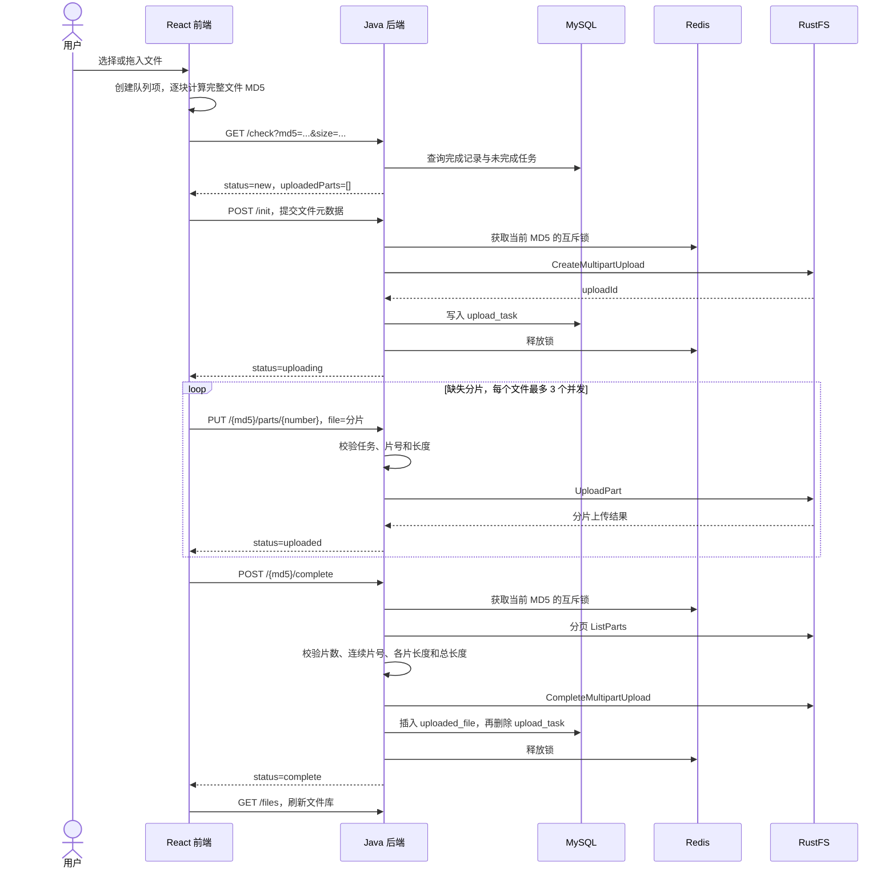
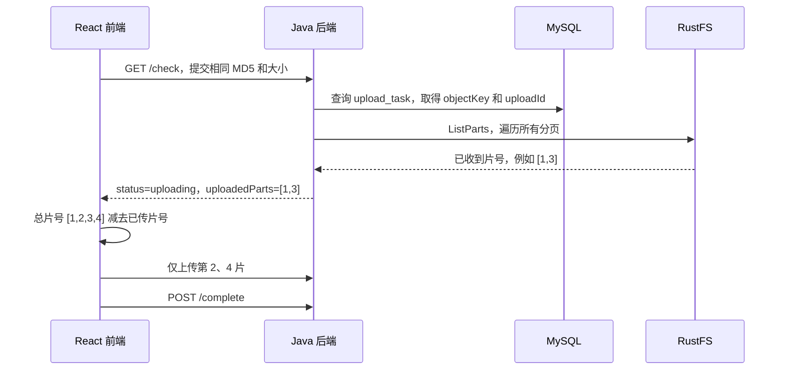
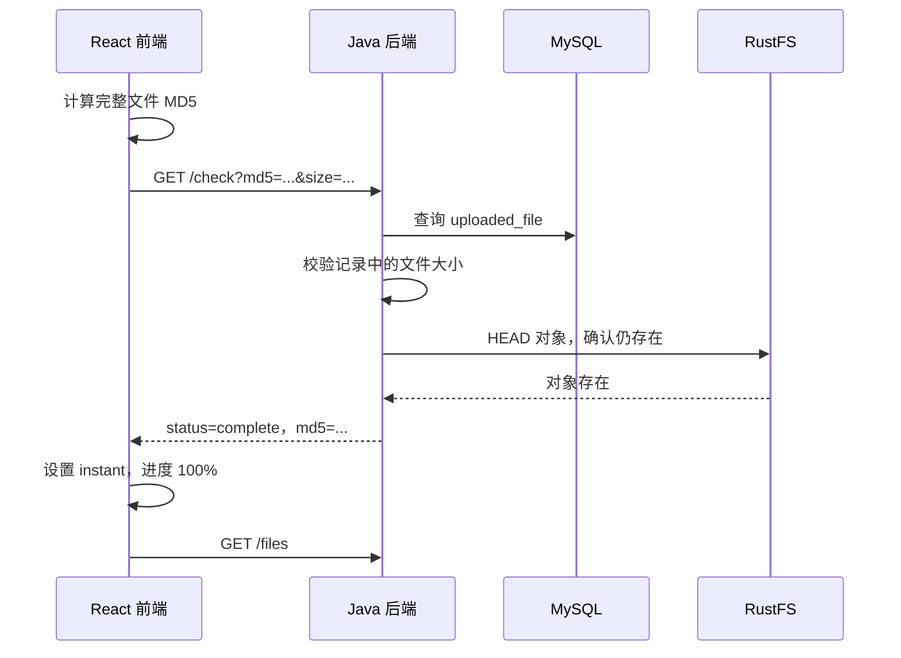

# 前后端分片上传、断点续传与秒传交互逻辑

本文依据当前项目代码编写，说明实际实现的请求顺序、数据保存位置及异常处理。文中的“秒传”指重复文件复用已有对象，仍需要读取本地文件计算 MD5。

## 1. 代码入口与职责

| 位置 | 职责 |
| --- | --- |
| `web/src/main.tsx` | 文件选择、MD5 计算、上传状态、并发上传、暂停、继续、取消及下载 |
| `web/src/upload.mjs` | 8 MiB 分片大小、总片数计算、缺失分片筛选、本地队列 ID |
| `UploadController.java` | HTTP 接口、参数接收与异常响应 |
| `UploadService.java` | 查询任务、初始化、分片转发、合并、取消、文件列表及预签名下载 |
| `UploadRules.java` | 元数据、片号、分片长度及恢复对象长度校验 |
| `upload/persistence/UploadTask.java`、`UploadedFile.java` | MyBatis-Plus 实体，与现有任务表和完成表映射 |
| `upload/persistence/*Mapper.java` | 继承 BaseMapper，执行查询、插入和删除 |
| `upload/persistence/MybatisPlusConfig.java` | Mapper 扫描与分页插件配置 |
| `src/main/resources/schema.sql` | 未完成任务表和已完成文件表 |

后端 Java 文件位于 `src/main/java/com/winter/awss3uploadv2/upload/`。

当前数据访问使用 MyBatis-Plus，MD5 主键使用 `IdType.INPUT`，由前端文件指纹指定；实体显式映射下划线列名。任务查询和删除通过 `selectById`、`deleteById`，写入使用 `insert`。文件库使用分页插件在数据库中按 `created_at` 降序获取最近 100 条，再转换为原接口的下划线字段，前端无需修改。创建时间使用原表默认值；数据库表结构和跨存储处理顺序保持一致。

| 参与方 | 保存或处理的内容 |
| --- | --- |
| 浏览器 | 本地 `File`、完整文件 MD5、队列状态、请求控制器 |
| 后端 | 校验请求，将分片流转发给 RustFS，协调任务状态 |
| MySQL | `upload_task` 保存未完成任务，`uploaded_file` 保存完成记录 |
| Redis | 同一 MD5 的初始化、合并、取消互斥锁 |
| RustFS | 分片会话、已上传分片及最终对象；实际分片进度以此为准 |

上传数据经过“浏览器 → 后端 → RustFS”，没有采用浏览器直传预签名 PUT 的方式。下载则由后端生成预签名 GET 链接，浏览器直接访问 RustFS。

## 2. 前后端共同遵守的协议

### 2.1 标识不能混用

| 标识 | 生成方 | 用途 |
| --- | --- | --- |
| `item.id` | 前端 `createUploadId()` | 区分页面队列项，不参与后端协议 |
| `md5` | 浏览器 SparkMD5 | 关联同一内容的任务和完成记录 |
| `objectKey` | 后端 | RustFS 桶内路径，格式为 `uploads/{md5}/{UUID}` |
| `uploadId` | RustFS | 标识一次 Multipart Upload 会话，仅保存在后端任务记录中 |
| `number` | 前端 | 分片编号，前后端和 S3 均从 **1** 开始 |

同内容不同文件名会使用相同 MD5；完成记录以 MD5 为主键，保留首次写入的文件名。用户文件名不会直接拼入对象路径。

### 2.2 分片计算

```text
CHUNK_SIZE = 8 × 1024 × 1024 = 8388608 字节
totalChunks = max(1, ceil(fileSize / CHUNK_SIZE))
start = (number - 1) × CHUNK_SIZE
end = number × CHUNK_SIZE
chunk = file.slice(start, end)
```

`Blob.slice()` 会自动截断超出文件末尾的结束位置。除最后一片外，每片必须恰好为 8 MiB；最后一片长度为 `fileSize - (totalChunks - 1) × CHUNK_SIZE`。

例如 20 MiB 文件分为三片：编号 1、2、3，长度分别为 8、8、4 MiB。后端同时校验片号和实际长度，禁止越界或错误切片。

MD5 计算按 **4 MiB** 逐块读取；上传按 **8 MiB** 切片。这两个大小承担不同职责，无须相同。

## 3. 正常分片上传的完整时序



`/init` 前置条件是桶已存在，当前代码不会在每次初始化时创建或检查桶。`/init` 返回的上传状态不包含 RustFS 的 `uploadId`，前端后续只传 MD5，由后端查表恢复会话标识。

### 3.1 前端如何并发上传

前端计算缺失片号列表 `missingParts(total, uploadedParts)`，使用共享游标取出下一片，启动 `min(3, 缺失片数)` 个异步上传任务。

每个任务完成一片后继续取下一片。所有任务通过 `Promise.all()` 汇合，全部成功才调用 `/complete`。这个并发上限是**每个文件三个请求**；选择多个文件时，每个文件分别启动上传，没有全局三请求上限。

分片请求使用 `FormData` 的 `file` 字段，不手动设置 `Content-Type`，由浏览器补上 multipart boundary。后端经 starter 调用 `uploadPart`，分片返回的 ETag 不在浏览器维护，合并时从 RustFS 获取。

### 3.2 进度如何显示

| 阶段 | 当前实现的进度计算 |
| --- | --- |
| 计算 MD5 | 只显示“MD5 计算中…”，不显示上传状态、百分比或进度条；计算完成即切换到上传阶段，隐藏 MD5 状态文字 |
| 上传分片 | 已确认完成片数 / 总片数 × 95% |
| 合并成功 | 设置为 100% |
| 秒传命中 | 直接设置为 100% |

上传进度以完整分片为单位更新，没有统计正在发送的单片字节数。MD5 计算阶段不参与上传百分比；进入上传阶段后按服务端已确认的分片数计算，95%～100% 用于等待合并结果，当前没有单独的 `merging` 页面状态。

## 4. 断点续传：重新询问 RustFS，上传缺失分片

### 4.1 中断时哪些数据保留下来

暂停、网络失败或浏览器关闭后，已成功提交到 RustFS 的分片和 MySQL 中的 `upload_task` 可以继续保留。后端不依赖前端记住上次进度，也不把浏览器显示的百分比作为恢复依据。



例如总片数为 4，服务端返回 `[1,3]`，前端只上传 `[2,4]`。所有编号均从 1 开始，无须再执行加一或减一转换。

### 4.2 暂停、继续、刷新和取消的区别

| 用户操作 | 前端行为 | 后端与 RustFS 行为 |
| --- | --- | --- |
| 暂停 | `AbortController.abort()`，队列状态设为 `paused` | 不主动删除任务或中止分片会话 |
| 继续 | 创建新的控制器，重新调用 `/check` | 返回 RustFS 实际保留的分片 |
| 刷新后重选文件 | 重建页面队列，重新计算 MD5，再调用 `/check` | 仍可根据 MySQL 任务找到原会话 |
| 取消 | 先停止本轮请求；如初始化进行中，等待其结束，再调用 DELETE | 中止分片会话后删除任务 |

浏览器中止 HTTP 请求不能保证服务器已停止处理，暂停瞬间的在途分片仍可能写入成功，因此继续时必须重新查询实际片号。

当前没有把 `File` 或队列持久化到 IndexedDB/localStorage。刷新后需要用户**重新选择同一个文件**，不会自动读取本地磁盘继续上传。若同一页面已保存完整 MD5，继续时会复用；哈希未完成就暂停时，需要重新计算。

`/check` 只有在 RustFS 明确返回 `NoSuchUpload` 错误码时才删除失效任务并返回 `new`。其他 400、404、502 等错误继续上抛并保留任务，不会仅凭 HTTP 状态码清理断点记录。初始化响应同时返回最新的 `uploadedParts`，前端用此响应覆盖初始化前的状态，避免并发初始化时重传已完成分片。

## 5. 秒传：复用完整对象



命中后不会再调用初始化、分片上传或合并接口。它省去的是文件网络传输，浏览器仍需读取完整文件以计算 MD5，因此大文件秒传仍有本地计算时间。

若数据库有完成记录而 RustFS 对象已经不存在，后端删除失效记录，随后继续检查未完成任务或返回 `new`。若同一 MD5 对应的大小不同，后端拒绝请求，而不是直接复用。

完整 MD5 由浏览器提交，后端仅校验格式，不重新读取合并对象计算完整摘要；当前也没有计算并传递每一片的业务 MD5。因而这里的去重不是服务端已经验证过的内容真实性证明，也不承担鉴权职责。

## 6. 接口协议

所有路径以 `/api/uploads` 为前缀。成功响应直接是业务 JSON，没有统一的 `code/data/message` 包装。

### 6.1 查询状态

```http
GET /api/uploads/check?md5=0123456789abcdef0123456789abcdef&size=20971520
```

三种响应示例：

```json
{"status":"new","uploadedParts":[]}
```

```json
{"status":"uploading","uploadedParts":[1,2]}
```

```json
{"status":"complete","md5":"0123456789abcdef0123456789abcdef"}
```

`uploadedParts` 可能为空；前端应根据 `status` 决定是否初始化，不能以数组是否为空代替任务状态。完成响应不包含此数组或下载地址。

### 6.2 初始化

```http
POST /api/uploads/init
Content-Type: application/json
```

```json
{
  "md5":"0123456789abcdef0123456789abcdef",
  "fileName":"example.zip",
  "fileSize":20971520,
  "totalChunks":3,
  "contentType":"application/zip"
}
```

新建或复用任务返回 `{"status":"uploading","uploadedParts":[已确认的片号]}`，新任务的片号数组为空；已存在完成记录且大小一致时返回 `{"status":"complete"}`。MD5 必须是 32 位十六进制字符，文件大小不能为负，文件名不能为空且长度不超过 255，片数必须与 8 MiB 协议匹配。

`contentType` 由前端优先从 `File.type` 获取，缺失时按常见扩展名补充，再回退为 `application/octet-stream`。所有格式都允许上传，不设类型白名单，也不传递文件头样本。后端不检测文件内容，只规范化 MIME 的 HTTP 头格式；缺失或非法格式会使用通用二进制类型，不会因此拒绝文件。

### 6.3 上传单片

```http
PUT /api/uploads/0123456789abcdef0123456789abcdef/parts/1
Content-Type: multipart/form-data; boundary=浏览器自动生成
```

表单字段 `file` 为该片二进制，成功返回 `{"status":"uploaded"}`。相同会话、相同片号重传会覆盖该片；后端并不在 MySQL 中为每片单独建记录。

### 6.4 合并

```http
POST /api/uploads/0123456789abcdef0123456789abcdef/complete
```

不需要请求体。后端核对 RustFS 全部分片：数量等于任务片数、排序后片号连续为 `1..N`、各片大小符合规则、累计长度等于文件大小，最后通过 starter 提交合并。成功返回 `{"status":"complete"}`。

### 6.5 取消

```http
DELETE /api/uploads/0123456789abcdef0123456789abcdef
```

成功返回 `{"status":"cancelled"}`。任务不存在也按成功处理；不会删除已完成记录或已完成文件。中止 RustFS 失败时保留本地任务并返回错误，便于后续再次清理。

### 6.6 文件列表和下载

`GET /api/uploads/files` 返回最近 100 条完成记录，字段为 `md5`、`file_name`、`file_size`、`created_at`。

`GET /api/uploads/files/{md5}/download` 返回 `{"url":"预签名下载地址"}`，链接有效期 15 分钟。前端在新窗口打开链接；过期后重新获取，不把它作为永久 URL 保存。

对象的 Content-Type 在分片初始化时使用前端提交的 `contentType`，而非单片表单类型。视频访问链接在签名前添加 `response-content-type` 和 `response-content-disposition=inline`，兼容历史错误类型的对象，但不会改写原对象元数据。文件库下载时前端可通过 `?contentType=video%2Fmp4` 提供类型提示；未提供该参数时后端读取对象已有元数据，不读取内容检测。已存在的分片会话仍保留创建时的类型。浏览器类型和扩展名均为元数据提示，不等于文件内容真实性检查或视频转码。

### 6.7 删除已完成文件

```http
DELETE /api/uploads/files/0123456789abcdef0123456789abcdef
```

成功响应 `{"status":"deleted"}`，记录不存在也返回成功；它与 `DELETE /api/uploads/{md5}` 取消未完成上传是不同的接口。

前端点击文件库中的“删除”后，先显示确认提示。确认后禁用该行按钮并显示“删除中…”，防止重复提交。后端按 MD5 获取互斥锁，读取完成记录中的对象键，调用 starter 的 `removeObject` 删除对象，成功后依次清理可能残留的任务和完成记录。

RustFS 删除失败时，不执行数据库删除，前端保留列表行并显示错误。对象删除成功而数据库操作失败时，可以再次调用删除接口；删除不存在的对象可安全重试。页面确认删除成功后移除文件库记录及本地已完成的同 MD5 队列项；不会把正在上传的队列项误当作完成文件移除。

目前去重记录按 MD5 全局共享，删除会影响同一对象的其他引用；当前没有回收站功能。删除完成后，该内容不再命中此记录的秒传。若存储桶启用了版本控制，删除当前对象并不等于永久清除所有历史版本。

## 7. 状态、数据库和并发控制

### 7.1 前端状态

| 状态 | 含义和后续动作 |
| --- | --- |
| `ready` | 新加入队列，随后自动启动 |
| `hashing` | 逐块计算完整 MD5，可暂停或取消 |
| `uploading` | 检查状态、初始化、传片或等待合并；可暂停或取消 |
| `paused` | 本轮已停止，点击继续后重新检查服务端 |
| `error` | 请求或处理失败，显示错误，点击继续重试整套检查流程 |
| `complete` | 本轮完成了上传和合并 |
| `instant` | 查询时命中已完成对象 |
| `cancelled` | 用户取消，队列进度归零 |

### 7.2 后端数据变化

| 阶段 | `upload_task` | `uploaded_file` | RustFS |
| --- | --- | --- | --- |
| 新文件 | 无 | 无 | 无会话或对象 |
| 初始化成功 | 保存 MD5、文件名、大小、片数、对象键、uploadId | 无 | 已创建分片会话 |
| 上传部分分片 | 保留任务 | 无 | 已保存部分分片 |
| 完成 | 先插入完成记录，再删除任务 | 保存 MD5、文件名、大小、对象键 | 保存最终对象 |
| 取消 | 中止会话成功后删除任务 | 不修改 | 清理该未完成会话的分片 |

零字节文件也创建任务，但 `upload_id` 为内部标记 `empty`，不调用 RustFS 分片初始化。前端跳过传片，直接调用合并；后端通过普通 `putObject` 写入零字节对象，再保存完成记录。

### 7.3 Redis 锁

锁键为 `upload:lock:{md5}`，通过 `SET NX` 获取并设置 60 秒过期时间。锁值是随机令牌，后台每 10 秒用 Lua 比较令牌并续租；释放时同样原子比较后删除。抢锁失败返回 409，不会排队等待。

初始化、合并和取消使用该锁，单片上传不使用，以支持并发。续租为尽力维护，长时间网络故障或 JVM 停顿可能使锁过期，当前没有额外的隔离令牌机制来阻止旧持有者继续操作。

## 8. 异常处理与恢复边界

| 场景 | 后端响应或处理 | 前端处理 |
| --- | --- | --- |
| MD5、大小、片数、片号或分片长度错误 | 400，`error` 描述参数问题 | 显示失败，不自动修正参数 |
| 任务忙、缺片或对象长度不一致 | 409，`error` 描述状态冲突 | 显示失败，允许手动继续 |
| RustFS 返回 S3 异常，例如上游 502 | 转换为 503，保留上游状态码 | 显示错误，允许手动继续 |
| 某个分片失败 | 原有任务和已上传分片保留 | 中止本轮其他分片请求，状态设为 error |
| 暂停导致请求中止 | 浏览器端停止等待或发送 | 状态设为 paused |
| 数据库或其他未统一处理的异常 | 沿 Spring 默认异常处理返回 | 读取 error 字段，缺失时使用 HTTP 状态文本 |

上游 502 的响应示例：

```json
{"error":"RustFS unavailable (upstream HTTP 502); retry the upload"}
```

该提示只代表错误已被转换，**不代表 RustFS 或网关故障已经修复**。页面没有自动重试定时器，用户点击继续后才重新运行；SDK 自身配置的重试与页面手动重试属于不同层次。

当前跨存储恢复能力还存在以下边界：

- 初始化先申请 RustFS 会话再写数据库，只在主键冲突时补偿中止会话；其他写库失败可能留下无记录的会话。
- 合并时先提交对象，再写完成记录和删除任务，两条 SQL 当前独立执行。直接重试 `/complete` 可在任务仍存在时通过 HEAD 长度校验恢复记录。
- 但前端“继续”会先执行 `/check`。若对象已经合并而完成记录未写入，ListParts 可能返回 `NoSuchUpload`，当前 `/check` 会删除任务，因此上述直接合并重试的恢复能力并不覆盖所有页面重试路径。
- `/init` 也可能返回 `complete`；前端会处理该完成状态，并在复用任务时采用初始化返回的最新片号列表。
- MD5 是全局任务主键，同一内容的多个页面会共享会话；取消其中一个任务可能影响另一个页面。当前没有按用户或独立上传任务隔离。

以上是现有实现边界，不是本文已实现的新功能。

## 9. 对照参考前端的关系

核心顺序沿用了参考代码的“完整 MD5 → check → 初始化或续传 → 三路并发上传 → 合并”。当前项目采用独立页面与独立接口，没有原样复制 Ant Design 的 `WinterUpload` 组件。

| 项目 | 参考实现 | 当前项目 |
| --- | --- | --- |
| 上传分片大小 | 10 MiB | 8 MiB |
| 前端片号 | 从 0 开始，后端转换 | 整条链路从 1 开始 |
| 切片处理 | Web Worker 预处理切片并计算片摘要 | 上传时按需 slice，没有 Worker 预计算片摘要 |
| 页面集成 | 可复用组件，支持 value/onChange 等参数 | 独立上传队列和文件库页面 |
| 中断操作 | 取消会清理服务端任务 | 暂停保留任务，取消才调用 DELETE |

## 10. 手动联调步骤

1. 上传 20 MiB 文件，确认三片分别为 8、8、4 MiB，片号为 1、2、3。
2. 在部分分片成功后暂停，点击继续，确认 `/check` 返回的片号未再次进入缺失列表；暂停瞬间尚未确认成功的片可能重传。
3. 刷新页面后重选同一文件，确认重新计算 MD5 后仍可获取服务端进度。
4. 完整上传后再次选择相同内容文件，确认 `/check` 返回 `complete`，前端显示秒传，不发送分片。
5. 上传中点击取消，确认收到 `cancelled`；再次选择文件应重新初始化。
6. 上传空文件，确认没有 PUT 分片请求，直接通过完成接口创建空对象。
7. 模拟存储错误，确认页面展示错误并保留重试入口；上游恢复后再点击继续。

本文只说明当前协议与代码行为。文档编写没有修复或重新验收之前出现的 Java 客户端初始化 502 问题。

## 11. 文件预览

已存文件列表提供预览弹窗：前端根据 MIME 提示选择 video、audio、img 或 PDF iframe。打开时请求现有预签名链接接口并显示加载状态；图片、音视频和 PDF 的链接在签名前设置正确响应类型与 inline。HTML、压缩包等不支持的格式只提示下载，不影响上传能力。

弹窗支持关闭按钮、Esc 和点击背景退出，关闭会卸载媒体组件并中止仍在进行的链接请求。失败时提供提示及下载入口；新窗口打开使用同一短时链接。链接过期可关闭后重新打开。类型提示不保证视频编码被浏览器支持，PDF 是否嵌入展示也取决于浏览器阅读器。
